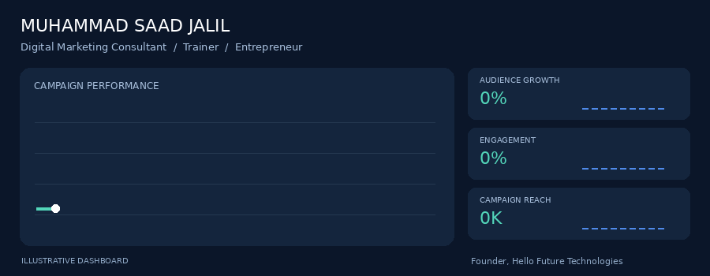
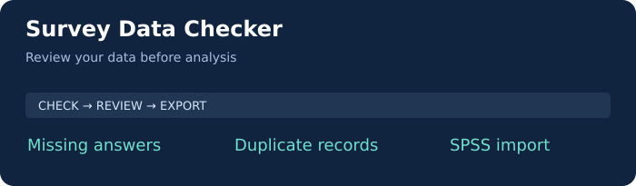

# Muhammad Saad Jalil

### Digital Marketing Consultant · Trainer · Entrepreneur

**Founder & CEO, [Hello Future Technologies](https://github.com/hellofuturetechnologies)** · Lahore, Pakistan

I help businesses and professionals strengthen their digital presence through digital marketing, SEO, training, and business consulting. Here on GitHub, I share practical tools for marketers, researchers, and small businesses.

## Featured tools

### Campaign Link Builder

Create campaign links for several channels and download them as a CSV.

[**Open tool**](https://hellofuturetechnologies.github.io/campaign-link-builder/) · [Source code](https://github.com/hellofuturetechnologies/campaign-link-builder)

### Marketing Metrics Calculator

Calculate CTR, CPC, CPM, CPL, CPA, conversion rate, and ROAS from campaign totals.

[**Open tool**](https://hellofuturetechnologies.github.io/marketing-metrics-calculator/) · [Source code](https://github.com/hellofuturetechnologies/marketing-metrics-calculator)

### Survey Data Checker

Check a survey export, review flagged responses, record corrections, and generate an SPSS import script.

[**Explore the project**](https://github.com/muhammadsaadjalil/survey-data-checker) · [Usage guide](https://github.com/muhammadsaadjalil/survey-data-checker#readme)

More from HFT: [CSV Quick Check](https://hellofuturetechnologies.github.io/csv-quick-check/) · [Social Media Image Resizer](https://hellofuturetechnologies.github.io/social-media-image-resizer/)

## Areas of work

| Area | Focus |
| --- | --- |
| Digital marketing & SEO | Search visibility, social media, campaign planning, and growth strategies |
| Training & consulting | Professional development, digital skills, and business strategy |
| Entrepreneurship | Building Hello Future Technologies and supporting businesses |
| Community & leadership | Volunteer management, youth engagement, and organizational initiatives |

## Experience & affiliations

| Organization | Role |
| --- | --- |
| Hello Future Technologies | Founder & CEO |
| Volunteers Leading Governance (VLG) | Volunteer Management Officer |
| Sitara-o-Hilal Foundation (SHF) | Volunteer Management Officer |
| International Global Network | Former Ambassador |
| TIDE Digitalize | Former Marketing Manager |

My wider professional portfolio is available at [saadabbasi.pk](https://saadabbasi.pk/).

<strong>More projects</strong>

### Developer Playground

Four dependency-free Python utilities for text statistics, JSON formatting, CSV analysis, and SHA-256 checksums.

[Repository](https://github.com/muhammadsaadjalil/developer-playground) · [Release v1.0.0](https://github.com/muhammadsaadjalil/developer-playground/releases/tag/v1.0.0) · [Contributing](https://github.com/muhammadsaadjalil/developer-playground/blob/main/CONTRIBUTING.md)

### Selected organizational projects

| Project | Purpose |
| --- | --- |
| Hello Future Technologies website | Company services and content |
| BEAIGA Store | E-commerce and ordering workflows |
| RB Ventures | Institutional website and content management |
| VLG E-Voting Portal | Election management and voting workflows |
| VLG Letter Management | Internal records and document workflows |
| HFT Books | Accounting and financial reporting |

## Get in touch

For marketing, training, and business inquiries, email [contact@saadabbasi.pk](mailto:contact@saadabbasi.pk) or [book a consultation](https://calendly.com/muhammadsaadjalil/30min).

[Website](https://saadabbasi.pk/) · [LinkedIn](https://www.linkedin.com/in/muhammad-saad-jalil/) · [Hello Future Technologies](https://github.com/hellofuturetechnologies)
